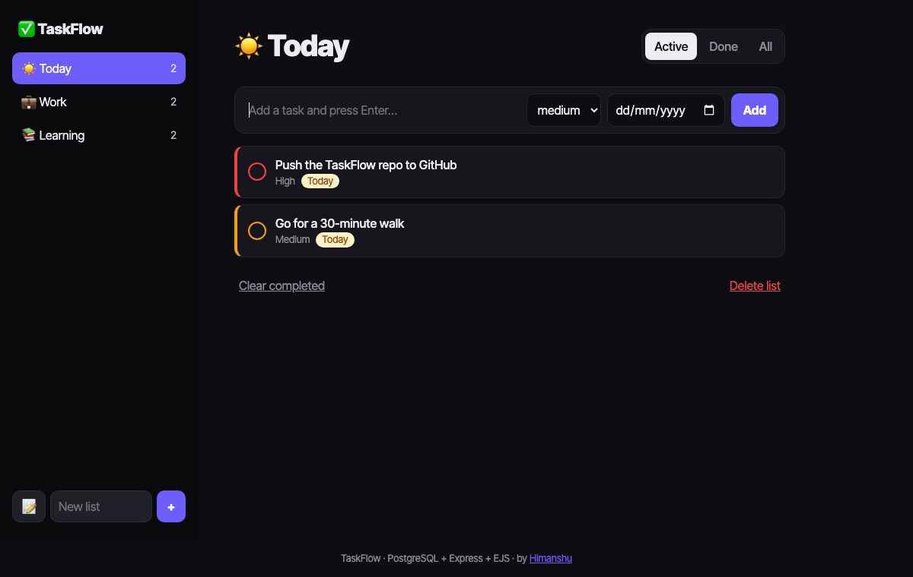

# ✅ TaskFlow

> A PostgreSQL-backed task manager with multiple lists, priorities, due dates, smart sorting, filters, inline editing and overdue badges. Built with Express, EJS and `pg`, and it works without client-side JavaScript.

**🔗 Live demo:** https://taskflow-hnse.onrender.com/ *(free tier: the first visit after idle takes ~30–60s to wake up)*

[](https://github.com/himanshuuem/taskflow/actions/workflows/test.yml)




## ✨ Features

- **Multiple lists** with emoji, open-task counts and a red **overdue** badge, all computed in one query with `count(...) FILTER (WHERE ...)`.
- **Priorities as a Postgres `ENUM`** (`low < medium < high`), so `ORDER BY priority DESC` just works. Tasks sort by status, then priority, then due date (`NULLS LAST`).
- **Due dates** with friendly labels: *Today*, *Tomorrow*, *3 days overdue*, *Fri 31 Oct*.
- **Filters:** Active, Done and All, preserved across actions.
- **Inline editing** of title, priority and date (<kbd>Esc</kbd> cancels), plus toggle, delete and "clear completed".
- **Validation** in the app (trimming, length, enum, date format) and in the database (`CHECK`, `NOT NULL`, FK `ON DELETE CASCADE`, `UNIQUE` list names mapped from error `23505` to a friendly message).
- **POST-redirect-GET** everywhere, a composite index on `(list_id, done, due_on)` and graceful pool shutdown.

## 🗄️ Schema

```sql
CREATE TYPE priority AS ENUM ('low', 'medium', 'high');
lists (id SERIAL PK, name UNIQUE, emoji)
tasks (id SERIAL PK, list_id FK → lists ON DELETE CASCADE, title, priority, due_on DATE,
       done BOOLEAN, created_at, done_at)
```

## 🚀 Run Locally

```bash
git clone https://github.com/himanshuuem/taskflow.git
cd taskflow
npm install
cp .env.example .env     # set DATABASE_URL
npm run db:setup         # schema + sample lists and tasks
npm run dev              # http://localhost:3000
DATABASE_URL=postgres://... npm test
```

## ☁️ Deploy (free)

`render.yaml` provisions a free Postgres database and web service.

## 📚 Origin

This is an upgrade of **Permalist**, the to-do app from the PostgreSQL section of [The Complete Web Development Bootcamp](https://www.udemy.com/course/the-complete-web-development-bootcamp/), with lists, priorities, due dates and tests added.

---

Made by [Himanshu](https://github.com/himanshuuem)
